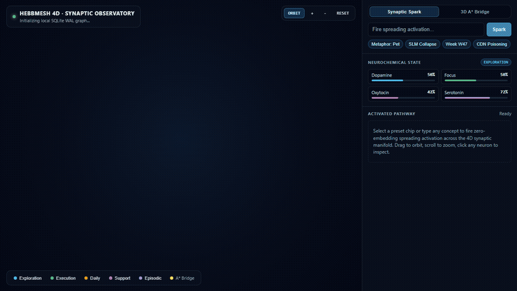

# HebbMesh

**Zero-Bloat 4D Synaptic Memory over Plain Markdown.**  
*Zero Docker · Zero Vector DBs · Zero npm Dependencies · Native `node:sqlite` WAL.*  
**Technical Report (v1.1 · Zenodo DOI):** [10.5281/zenodo.24451147](https://doi.org/10.5281/zenodo.24451147)

> **Why HebbMesh?** Most AI agent memory stacks either dump raw Markdown into your context window (burning tokens) or force you to maintain Docker, Postgres/Qdrant, and heavy local embedding runtimes. **HebbMesh** treats plain Markdown files as your 20-year source of truth and compiles them into a 4D/3D associative synaptic graph in **~39 ms** with **0 external dependencies**.



---

## 60-Second Quickstart

Requires **Node.js >= 22.5** (for native `node:sqlite`). No `npm install` needed.

```bash
git clone https://github.com/victormunoz-sec/hebbmesh.git
cd hebbmesh

# 1. Run the live 3D Brain Viewer + synthetic demo (100% offline, 127.0.0.1:4322)
node demo.mjs

# 2. Run the reproducible head-to-head benchmark vs SQLite FTS5 (BM25)
node bench/benchmark.mjs
```

---

## How to Use HebbMesh in Your Own Agent (3 Ways)

### 1. Plug into Claude Code, OpenCode, Cursor, or Antigravity (CLI / Session Hook)
Stop dumping 40 KB of stale history into `CLAUDE.md` or `AGENTS.md`. Point HebbMesh at your own Markdown folder and inject only the **5–6 relevant neurons (~150 tokens)** in ~3 ms:

```bash
# Human-readable context injection (great for SessionStart hooks)
node src/engine.mjs spark ./my-memory "stripe webhook duplicate charge"

# Machine-readable JSON (for Python / Node / MCP wrappers)
node src/engine.mjs spark ./my-memory "stripe webhook duplicate charge" --json

# Discover hidden 3D A* bridge between two separate topics
node src/engine.mjs bridge ./my-memory "stripe webhook" "cloudflare waf"
```

### 2. Embed in Any Custom Node.js Bot or Agent (3 Lines)
No Docker, no Qdrant, no OpenAI embedding calls:

```js
import { activateNetwork, findBridge } from './src/engine.mjs';

// Call right before sending the prompt to Claude, Gemini, DeepSeek, or Ollama:
const mem = activateNetwork('./my-memory', userMessage, { topK: 5 });
const context = mem.winners.map((w) => `[${w.code}] ${w.summary}`).join('\n');
```

### 3. Visualize Your Own Markdown Second Brain Offline
Drop plain `.md` files (`lessons.md`, `graph.md`, `milestones.md`, `profile.md`, `inbox.md`, `knowledge/*.md`, `synthesis/YYYY-Wnn.md`) into any folder and launch the 3D Viewer directly on your data:

```bash
node demo.mjs ./my-memory
# -> Opens 100% offline 3D Synaptic Observatory at http://127.0.0.1:4322
```

**Tip — Write Memories with Zero-Embedding Seeds (`| sem:`):**
When your agent saves a new lesson or note, append 3–5 synonyms or metaphors inline:
```markdown
- **A-01 `[V]` Idempotent Stripe Webhooks:** Persist `event.id` before mutating balances. | sem: double charge, duplicate payment, billing bug
```
HebbMesh automatically compiles those seeds into high-weight dendrites (`0.80`) with **0 MB** of embedding models.

---

## Preregistered Blind Benchmark v1.1

Evaluated under strict preregistration (`PROTOCOLO_PREREGISTRO.md`) on a synthetic **187-neuron** developer memory base (**1,447 edges** across Knowledge Graph, Lessons, Milestones, Profile, Knowledge Docs, 4 Weekly Syntheses, and an isolated Private Vault) with **80 blind external queries** distributed across **33 thematic clusters**, Hebbian online learning OFF, and 10,000x cluster bootstrap.

Run `node bench/benchmark.mjs` to reproduce on your own machine:

### Condition A (Principal — Blind Regenerated Seeds `seeds_regenerated.json`)

| Engine / Variant | Direct@3 | Semantic@3 | MultiHop@3 | Episodic@3 | Mean Latency | p95 Latency | Ep. Violations |
|---|---:|---:|---:|---:|---:|---:|---:|
| **1. SQLite FTS5 (BM25 pure)** | 100% | 0.0% | 100% | 90% | 0.80 ms | 1.35 ms | 0/4 |
| **2. SQLite FTS5 + \| sem:** | 100% | 33.3% | 100% | 90% | 0.81 ms | 1.34 ms | 0/4 |
| **3. HebbMesh sin \| sem:** | 90% | 6.7% | 95% | 80% | 5.34 ms | 10.87 ms | 0/4 |
| **4. HebbMesh sin propagacion (0 hops)** | 100% | 43.3% | 100% | 70% | 4.42 ms | 6.98 ms | 0/4 |
| **5. HebbMesh sin tope episodico (maxEp=Inf)** | 100% | 23.3% | 95% | 90% | 4.24 ms | 6.79 ms | 1/4 |
| **6. HebbMesh Full 4D** | 100% | 23.3% | 95% | 80% | 3.52 ms | 5.04 ms | 0/4 |

### Honest Scientific Takeaway & Statistical Analysis (10,000x Cluster Bootstrap)

- **Zero-Embedding Seeding (`| sem:`) drives the lexical-to-semantic leap:** Adding inline semantic synonyms lifts semantic retrieval from 0.0% to 33.3% on pure SQLite FTS5 and to 43.3% on HebbMesh 0-hop, with zero local embedding model overhead.
- **Multi-hop Spreading Activation trade-off:** Multi-hop spreading activation currently dilutes zero-overlap semantic queries (43.3% on 0 hops drops to 23.3% on Full 4D), while protecting multi-hop associative recall (95%).
- **Paired Bootstrap vs SQLite FTS5 + \| sem::** Verified `PARIDAD_+-5` on Direct retrieval (100% vs 100%) and `INCONCLUSO` on Semantic (Full 4D vs FTS5+|sem: point -10.0%, 95% CI [-24.0%, +3.6%]), MultiHop (point -5.0%, 95% CI [-15.8%, 0.0%]), and Episodic (point -10.0%, 95% CI [-37.5%, 0.0%]).
- **Hebbian Drift Stability (50 repeated queries across 2 active clusters):** Edge Gini coefficient moved from 0.1141 to 0.1183 (+0.0042 delta, zero rich-get-richer runaway); 0.0 pts hit@3 degradation across all 4 categories (Direct 100%, Semantic 23.3%, MultiHop 95%, Episodic 80%).
- **Privacy Firewall Red-Team (16 adversarial probes with mandatory Positive Control):** 16/16 probes trigger private target detection with Firewall OFF (Positive Control); **0/16 leaks** with Firewall ON across literal tokens, partial fragments, semantic paraphrases, and 3D A\* bridges, with 0 lateral dendrite leaks.

**Footprint:** `456 KB` SQLite WAL index (`.hebbmesh.sqlite`) · `39.44 ms` compile · `128.9 MB` RSS · `0` external npm dependencies · `0` network calls.

---

## Five Core Mechanisms

1. **Zero-Embedding Seeding (`| sem:`):** Instead of bundling 100+ MB ONNX embedding models, the LLM capturing a memory appends 3–5 synonyms or idioms inline (`| sem: furry friend, dog, companion`). HebbMesh compiles them as high-weight dendrites (`0.80`), lifting semantic/metaphor retrieval from **0.0% (BM25 pure)** to **33.3%–43.3%** with **0 MB runtime overhead**.
2. **O(1) Hebbian Persistence over `node:sqlite` WAL:** Co-activated neurons strengthen their edges incrementally in a single SQLite transaction without rewriting full JSON graphs, while allowing concurrent reads from the 3D Viewer.
3. **Weekly Episodic Consolidation with Triple Anti-Super-Hub Throttling (`S-Wnn-F1..F4`):** Weekly syntheses are partitioned into 4 functional lobes (`Daily`, `Exploration`, `Execution`, `Support`), capped at backing weight (`z=0.62`), and throttled to `maxEpisodic = 1` per query so broad recaps never crowd out surgical engineering lessons.
4. **3D A\* Synaptic GPS Bridge (`findBridge`):** Finds non-obvious shortest paths between disjoint concepts across 3D `(X, Y, Z)` space (e.g., `"stripe webhook" -> "cloudflare waf"` resolves `A-01 -> HITO-1 -> HITO-6 -> A-04` in `<5 ms`) with **anti-pareidolia hub tolls** and a **strict Privacy Firewall**.
5. **Privacy Firewall by Construction:** Nodes in `private_vault.md` are excluded before spreading activation, before A\* pathfinding (preventing graph triangulation leaks), and at the HTTP viewer boundary (`127.0.0.1` only, zero wildcard CORS).

---

## Architecture

```text
  Plain Markdown Files (20-Year Source of Truth)
  ├── graph.md           (G-xx temporal [V]/[S] edges)
  ├── lessons.md         (A-xx engineering rules + | sem: + | eco:)
  ├── milestones.md      (HITO-xx project timeline)
  ├── profile.md         (PERFIL-xx routines & preferences)
  ├── knowledge/*.md     (DOC-xx technical library -> Anti-Redundancy Map)
  ├── synthesis/Wnn.md   (S-Wnn-F1..F4 episodic chapters)
  └── private_vault.md   (PRIV-xx isolated by Privacy Firewall)
           │
           ▼  compile (~39 ms, 0 deps)
  .hebbmesh.sqlite (WAL · O(1) Hebbian Updates · ~456 KB)
           │
     ┌─────┴──────────────────────────┐
     ▼                                ▼
  CLI / Agent Hook               Offline 3D Viewer
  (spark + 3D A* bridge)         (127.0.0.1:4322 · 0 CDN deps)
```

---

## Security by Construction

Most open-source AI memory prototypes ignore security boundaries. **HebbMesh** is built with adversarial AppSec rigor ([`SECURITY.md`](./SECURITY.md)):

- **Zero Supply-Chain Risk:** `0` npm dependencies and `0` external CDNs — runs 100% offline on native Node.js built-ins.
- **Graph-Layer Privacy Firewall (Zero Lateral Leakage):** `private_vault.md` nodes are isolated before edge weaving, before 1-hop dendrite diffusion (preventing private tags from leaking into public neighbors), before spreading activation, and before 3D A\* pathfinding (with uniform non-oracle responses).
- **Hardened Offline 3D Viewer:** Strictly bound to `127.0.0.1:4322`, zero wildcard CORS, strict `Content-Security-Policy`, `Sec-Fetch-Site: cross-site` rejection on `/api/*`, no local OS paths leaked in API JSON, and **0 `.innerHTML` sinks** (DOM-XSS immune).
- **Zero SQL Injection:** 100% parameterized prepared statements (`?`) across `node:sqlite` WAL storage.

---

## Dual Licensing (Open Source + Commercial)

- **Open Source:** Licensed under **GNU AGPL-3.0-or-later** ([`LICENSE`](./LICENSE)). Free to inspect, study, benchmark, and self-host.
- **Commercial License:** Embedding HebbMesh inside proprietary SaaS platforms, closed-source agent fleets, or commercial products without AGPL source-disclosure obligations requires a Commercial License ([`COMMERCIAL_LICENSE.md`](./COMMERCIAL_LICENSE.md)).

---

## Turnkey Production Setup & Custom Agent Architecture

- **Iris Starter Kit (Coming Soon on Gumroad):** Pre-wired hooks for Claude Code, OpenCode, Cursor, and Antigravity + automated nocturnal REM consolidation + 4-phase weekly synthesis + guided Specialist Agent Factory + `firmas.mjs` token-diet suite.
- **Consulting, Evals & Commercial Licensing:** Building AI agents, model evals (SLM ontological load / context isolation), or low-cost multi-agent harnesses? Contact **Victor Muñoz Jara** (Independent AI Systems & Security Researcher) at `victormunoz.research@gmail.com`.

---

## Citation

If you reference HebbMesh, its pre-registered ablation protocol, or Zero-Embedding Seeding (`| sem:`), please cite the v1.1 Technical Report:

```bibtex
@techreport{munozjara2026hebbmesh,
  author      = {Mu{\~n}oz Jara, Victor},
  title       = {Zero-Bloat Synaptic Memory over Markdown: A Pre-Registered Empirical Study of Write-Time Semantic Seeding, Graph Propagation Ablations, and Privacy Firewalls for Local-First LLM Agents},
  institution = {Independent AI Systems \& Security Research},
  year        = {2026},
  month       = nov,
  version     = {1.1},
  doi         = {10.5281/zenodo.24451147},
  url         = {https://doi.org/10.5281/zenodo.24451147}
}
```
